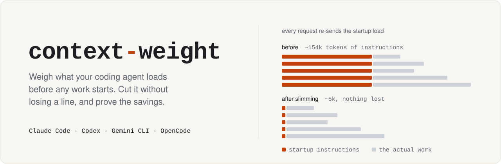
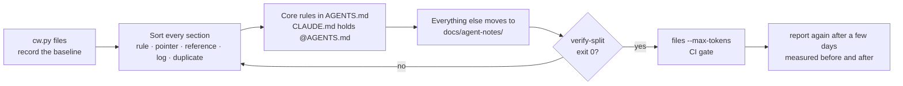

<p align="center">
  <picture>
    <source media="(prefers-color-scheme: dark)" srcset="assets/banner-dark.svg">
    
  </picture>
</p>

<p align="center">
  <a href="https://github.com/ohm41321/context-weight/actions/workflows/ci.yml"></a>
  
  
  
  
  <a href="LICENSE"></a>
</p>

<p align="center">
  <a href="#quick-start">Quick start</a> ·
  <a href="#what-you-get">What you get</a> ·
  <a href="#slim-without-losing-a-line">Slimming</a> ·
  <a href="#keep-it-slim-in-ci">CI gate</a> ·
  <a href="#what-each-agent-loads">Loading rules</a> ·
  <a href="#faq">FAQ</a>
</p>

---

Coding agents send their startup context again with **every request** in a
session: `CLAUDE.md`, `AGENTS.md`, `GEMINI.md`, rules, `@imports` and the skill
listing. A 150k-token `CLAUDE.md` costs 150k tokens per request before the
agent reads a single line of your code.

**context-weight** is an agent skill and a zero-dependency Python script. It does four things:

| | |
| --- | --- |
| **Weigh** | Lists what each agent loads at startup, following that agent's real loading rules. |
| **Measure** | Shows how large your sessions really get, from the session logs already on your machine. |
| **Slim** | Gives your agent a procedure to cut instruction files, then **proves no line was lost**. |
| **Guard** | Fails CI when instructions grow back. |

It works with **Claude Code, Codex, Gemini CLI and OpenCode**, on any repo.

## Quick start

Pick the line for your agent. Each one is a single step.

**Claude Code**: type this in a session.

```text
/plugin install context-weight --marketplace ohm41321/context-weight
```

**Codex**

```bash
codex plugin marketplace add ohm41321/context-weight && codex plugin add context-weight@context-weight
```

**Any agent** (Claude Code, Codex, Gemini CLI, OpenCode, Cursor and [more](https://skills.sh)), with Node installed:

```bash
npx skills add ohm41321/context-weight
```

**No Node**: Python is enough.

```bash
git clone https://github.com/ohm41321/context-weight.git && python3 context-weight/install.py
```

Restart your agent and ask it to **"weigh this repo's context"**. It runs the report and
hands you a picture of it.

To try it without installing anything, run the script straight from GitHub. It never changes
your files: it writes the picture to a new folder in the temp folder and opens it.

```bash
curl -fsSL https://raw.githubusercontent.com/ohm41321/context-weight/main/skills/context-weight/scripts/cw.py | python3 - report . --open
```

## What you get

One picture of everything that loads before your agent starts work, and what it costs:

```bash
cw.py report . --open
```

<p align="center">
  <picture>
    <source media="(prefers-color-scheme: dark)" srcset="assets/report-dark.svg">
    
  </picture>
</p>

<p align="center"><sub>Sample drawn from made-up data by <code>assets/make_report_demo.py</code>.</sub></p>

| Part | What it tells you |
| --- | --- |
| Big number | The largest instruction-file load at startup, in tokens. It is sent again with every request. |
| Before and after | Shown once you have slimmed. The report finds the change in git by itself (uncommitted, or the commit or merge that cut the files) and sets this repo's files then and now beside measured startup in the sessions before and after it. Fewer than 3 sessions after the change are marked too early. |
| Tiles | Measured: the real first request (instruction files plus system prompt, tools and skill listing), how much of all input that load is, and what slimming would save. |
| Loaded at startup | Each agent's load, split into this repo and everything outside it (your global files, plugins). The thin line is your target. |
| Heaviest files | What to slim first. A red mark means Codex cuts the file off and never reads the rest. |
| Skill listing | The installed skills' names and descriptions against each agent's budget. Red means over budget: descriptions get dropped and skills stop triggering. |
| Sessions | Measured from your local logs. *Startup* is the median first request; *startup share* is how much of all input was that load being re-sent. |
| What to do | Ranked fixes. Each names the cause, the size of the effect and the change that fixes it. |

`--svg FILE` writes the picture to FILE, and `--svg` alone puts it in the temp folder.
`--theme light` or `dark` fixes the colors; the default follows the viewer. Leave out
`--svg` and the same numbers print as plain text; `--json` gives them to scripts.

### Commands

| Command | Answers |
| --- | --- |
| `cw.py report [PATH]` | Everything for one repo, plus ranked findings and the before and after of your last slimming. `--svg` or `--open` draws it; `--compare-at DATE` sets the split |
| `cw.py files [PATH]` | Which instruction files each agent loads at startup, in tokens |
| `cw.py skills [PATH]` | Size of the skill listing against each agent's budget |
| `cw.py sessions` | Context size per project, measured from logs. `--compare-at DATE` shows before and after |
| `cw.py verify-split OLD NEW...` | Whether every line of OLD still exists somewhere in NEW |

Every command takes `--json`. Exit codes: `0` ok, `1` a check failed, `2` bad
input such as a missing path or bad date. A typo therefore never passes a gate.

## Slim without losing a line

The skill walks your agent through this loop. It ends only when the numbers
say so.



`verify-split` is strict where strictness matters:

- **Every line counts.** That includes short ones like `No.`. Lines with no
  letter or digit, such as rules and table separators, are skipped.
- **Copies count.** If a line appeared twice, removing one copy shows up as a
  loss.
- **Code keeps its shape.** Flattening indented YAML or Python inside a code
  block is a loss. Re-wrapping prose is not.
- **The backup cannot vouch for itself.** The old file is never counted as its
  own copy.
- **Deliberate drops are explicit.** You list them in `dropped.txt`, and the
  agent asks you first.

The full procedure is in [`references/slimming.md`](skills/context-weight/references/slimming.md).

## Keep it slim in CI

```yaml
# .github/workflows/context-weight.yml
name: context-weight
on: [pull_request]
jobs:
  instructions-budget:
    runs-on: ubuntu-latest
    steps:
      - uses: actions/checkout@v4
      - name: Agent instructions stay under 6k tokens
        run: |
          curl -fsSL https://raw.githubusercontent.com/ohm41321/context-weight/main/skills/context-weight/scripts/cw.py -o cw.py
          python3 cw.py files . --max-tokens 6000
```

The gate fails when any agent's repo instructions pass the limit. It also fails
when Codex would cut part of `AGENTS.md` off at its 32 KiB cap. Replace `main`
with a commit SHA if you want reproducible builds.

<details>
<summary>As a pre-commit hook</summary>

Install the skill into the repo first with `python3 install.py --project .`, then:

```yaml
# .pre-commit-config.yaml
repos:
  - repo: local
    hooks:
      - id: context-weight
        name: agent instructions under 6k tokens
        entry: python3 .agents/skills/context-weight/scripts/cw.py files . --max-tokens 6000
        language: system
        pass_filenames: false
        files: (AGENTS|CLAUDE|GEMINI)\.md$
```
</details>

## What each agent loads

| | Claude Code | Codex | Gemini CLI | OpenCode |
| --- | --- | --- | --- | --- |
| **Instruction files** | `CLAUDE.md`, `.claude/CLAUDE.md`, `CLAUDE.local.md` in the working dir and every parent, plus `~/.claude/CLAUDE.md` | One `AGENTS.override.md` or `AGENTS.md` per dir, from the git root down, plus a global one | `GEMINI.md`, or the names in `context.fileName`, from the working dir up to the git root, plus a global one | `AGENTS.md`, falling back to `CLAUDE.md`, plus the `instructions` in `opencode.json` |
| **Also at launch** | Rules without `paths:`, `@imports` up to 4 hops deep, the first 200 lines of auto memory | | | |
| **Size limit** | Warns above 40,000 chars | **Silently cuts at 32 KiB** | | |
| **Skill listing budget** | 1% of the window, counted in characters | 2% of the window | Not published | Not published |
| **Session logs measured** | yes | yes | no | no |

Each rule, with sources and the date it was checked, is in
[`references/harnesses.md`](skills/context-weight/references/harnesses.md).
Agents change; when the docs and this table disagree, the docs win.

## How it compares

| | context-weight | [ctxweight](https://github.com/gonzaloperiane/ctxweight) |
| --- | --- | --- |
| Measures real sessions from local logs | Claude Code, Codex | no (static estimate) |
| Per-agent loading rules | Claude Code, Codex, Gemini CLI, OpenCode | CLAUDE.md, AGENTS.md, .cursorrules, skills |
| Proves a split lost nothing | `verify-split` | no |
| CI gate | `--max-tokens` | `--fail-on` |
| MCP schema cost | no | yes |
| Secret and PII scan | no | yes |
| Runtime | Python 3.8+, standard library only | Node.js |

Related skills: [`context-budget`](https://skills.sh/affaan-m/everything-claude-code/context-budget)
(a live meter plus a static audit),
[`claude-md-improver`](https://skills.sh/anthropics/claude-plugins-official/claude-md-improver),
[`claude-md-progressive-disclosurer`](https://skills.sh/daymade/claude-code-skills/claude-md-progressive-disclosurer),
[`codex-token-usage`](https://skills.sh/huajiexiewenfeng/codex-token-usage-skill/codex-token-usage).

From the same author: [Luciazero](https://github.com/ohm41321/luciazero) makes coding agents
prove their work, with a verify loop, a `/done` closeout and handoffs between agents. Its
doctrine is one of the always-loaded files context-weight keeps small.

## Install options

Use one method per agent. If you install the plugin and also copy the skill into a
skills folder, the agent lists it twice.

| Method | Install | Update | Remove |
| --- | --- | --- | --- |
| Claude Code plugin | `/plugin install context-weight --marketplace ohm41321/context-weight` | `/plugin update context-weight@context-weight` | `/plugin uninstall context-weight@context-weight` |
| Codex plugin | `codex plugin marketplace add ohm41321/context-weight`<br>`codex plugin add context-weight@context-weight` | `codex plugin marketplace upgrade context-weight` | `codex plugin remove context-weight@context-weight` |
| [skills CLI](https://github.com/vercel-labs/skills), any agent | `npx skills add ohm41321/context-weight` | `npx skills update` | `npx skills remove context-weight` |
| Python, every agent (symlink) | `python3 install.py` | `git pull` | `python3 install.py --uninstall` |
| Python, as a copy | `python3 install.py --copy` | `git pull`, then run it again | `python3 install.py --uninstall` |
| Python, one repo, committed with it | `python3 install.py --project path/to/repo` | run it again | `python3 install.py --project path/to/repo --uninstall` |

Claude Code older than 2.1.275 takes two steps: `/plugin marketplace add ohm41321/context-weight`,
then `/plugin install context-weight@context-weight`. As a plugin, the skill is named
`context-weight:context-weight`.

The Python install writes to `~/.agents/skills`, which Codex, Gemini CLI and
OpenCode read, and to `~/.claude/skills`, which Claude Code and OpenCode read.
It respects `$CLAUDE_CONFIG_DIR`. The installer never deletes a folder it did
not create: its copies carry a marker file, and anything else is left alone. On Windows, linking falls back to a copy when symlinks are not
allowed. `./install.sh` still works and calls `install.py`.

<details>
<summary>Layout</summary>

```text
context-weight/
├── .claude-plugin/                Claude Code plugin and marketplace manifests
├── .codex-plugin/plugin.json      Codex plugin manifest
├── install.py                     installer (install.sh calls it)
├── skills/context-weight/
│   ├── SKILL.md                   what the agent reads
│   ├── scripts/cw.py              the measuring script, stdlib only
│   └── references/
│       ├── harnesses.md           loading rules per agent, with sources
│       └── slimming.md            the slimming procedure
├── assets/make_report_demo.py     draws the sample report pictures from made-up data
├── tests/test_cw.py               unit tests on a synthetic HOME
└── .github/workflows/ci.yml       Linux, macOS, Windows; Python 3.8 to 3.13
```
</details>

## Accuracy and privacy

- **Read-only.** `cw.py` never changes, deletes or uploads your files, and it
  makes no network calls. The one file it writes is the picture you ask for with
  `--svg` or `--open`. For the before and after, `report` reads the repo's git
  history with read-only git commands, and weighs an older commit by copying its
  instruction files into a private temporary folder that it deletes afterwards.
  `install.py` writes only into skill folders.
- **No transcript content.** Session commands print numbers and paths only.
  `verify-split` prints lines from your own instruction files, because
  comparing them is its job.
- **Estimates are labelled.** File and skill token counts use about 3 ASCII
  characters per token and 1 token per Thai or CJK character. Fitted against
  Claude Code logs, they come within about 10%. Session numbers are what the
  provider reported.
- **Assumptions are printed.** Claude Code's logs do not record the model's
  context window, so the skill budget assumes 200k and says so. Use
  `--window 1000000` for 1M-context models. Codex reads its window from its
  own logs, and `--window` does not override it.

## FAQ

<details>
<summary><b>How is this different from <code>/context</code> or <code>/status</code>?</b></summary>

Those commands show how full the current session is right now. context-weight
looks at the repo and at your history: which files cause the load, how it
affected past sessions, and whether a change really reduced it.
</details>

<details>
<summary><b>Will the agent delete my notes?</b></summary>

No. Slimming moves text into `docs/agent-notes/` and leaves a pointer behind.
Nothing is dropped unless you agree to it, and the work is not done until
`verify-split` exits 0.
</details>

<details>
<summary><b>Why not use <code>@imports</code> to shrink CLAUDE.md?</b></summary>

Claude Code expands `@imports` at launch, so they organize the file but save
no context. Codex ignores them. Pointers with plain paths, which the agent
reads only when a task needs them, are what reduce the load.
</details>

<details>
<summary><b>My agent isn't listed.</b></summary>

The skill is a standard `SKILL.md` folder, so any agent that reads skills can
use it. The script knows the loading rules of four agents. Adding another means
adding one function in `cw.py` and a section in `references/harnesses.md`.
Pull requests are welcome.
</details>

## Development

```bash
python3 -m unittest discover -s tests -v
python3 assets/make_report_demo.py      # redraw the sample pictures in this README
```

CI runs the tests and the installer on Linux, macOS and Windows with Python
3.8 to 3.13. It also checks this repo's own instructions with the gate.

## License

[MIT](LICENSE)
